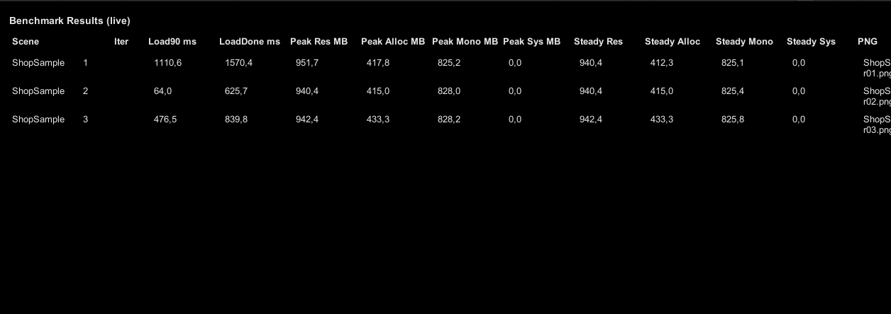

# Loading & Memory Benchmark Runner


A small tool that **loads your scenes one by one, measures load time and peak memory, and writes the numbers to CSV and PNG graphs**. It runs in the Editor and on real devices, so you can compare builds before and after an optimisation.



## What it measures

For every scene and every iteration:

| Metric | Meaning |
|---|---|
| `Load90` | ms until `LoadSceneAsync` reaches 90 % (assets loaded, before activation) |
| `LoadDone` | ms until the scene is fully loaded and activated |
| Peak allocated / reserved / Mono | peak memory during the load, sampled with `ProfilerRecorder` |

Between scenes the runner can force a GC and call `Resources.UnloadUnusedAssets()`, then wait for a stabilisation window, so every run starts from the same state.

## Usage

1. **Create a config:** *Create → Benchmark → Config*. The scene list syncs from Build Settings automatically (or use *Sync Scenes from Build Settings* in the context menu).
2. **In the Editor:** *Tools → Benchmark Runner → Run Benchmark*.
3. **On a device:** add `BenchmarkBootstrap` to your first scene, assign the config and build. With `runOnStartInPlayer` on, the run starts on launch.

### Config

| Field | Default | |
|---|---|---|
| `runMode` | `Auto` | `Auto`, `Editor` or `Player` |
| `iterations` | 3 | loads per scene |
| `sampleIntervalMs` | 50 | memory sampling interval |
| `stabilizationMs` | 1000 | wait after each load |
| `forceGCBeforeRun` / `unloadUnusedAssets` | on | clean state between scenes |

## Output

```
BenchmarkResults/<timestamp>/
├── metrics.csv            # one row per event: Load90, LoadDone, memory peaks
└── Graphs/
    └── <Scene>_iter01.png # memory over time for each load
```

The results folder lives under the platform's results root: the project folder in the Editor, persistent data on a device.

## Structure

`BenchmarkRunner` drives the loop, `GraphExporter` renders the PNGs, and `IPlatformServices` (`EditorPlatformServices`, `PlayerPlatformServices`) hides where files go and how scenes are opened on each platform.

## License

MIT
